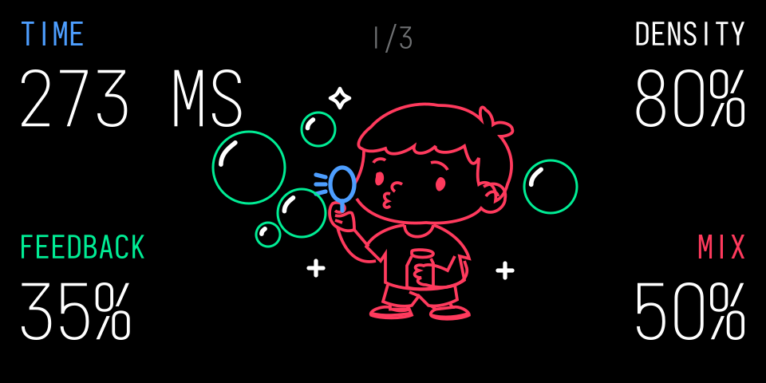
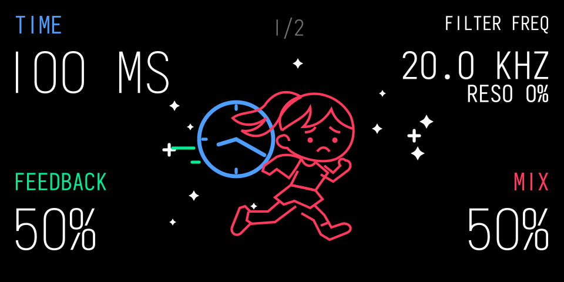
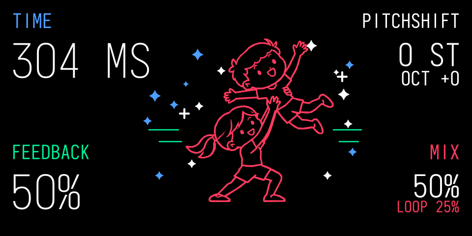

# ESC Delay Trio

Three mono delay effects by **ESC_CODE** for the **original Teenage Engineering OP-1**, ported and adapted from **Tom Erbe / SoundHack’s +bubbler, +delay and +pitchdelay**, using the **Opus framework**.

## Downloads

[Download all three devices and the illustrated manual](Delay-Trio-Bubbler-1.5.0-Delayed-1.0.0-Pitch-Delay-1.0.0.zip) · [Illustrated manual (PDF)](Delay%20Trio%20Illustrated%20Manual.pdf)

| Device | Version | Description | Download |
|---|---|---|---|
| Bubbler | 1.5.0 | Granular delay with overlapping grains, variable timing, pitch and reverse playback | [bubbler.opmod](bubbler.opmod) |
| Delayed | 1.0.0 | Delay with resonant feedback filter, Freeze and six LFO shapes | [delayed.opmod](delayed.opmod) |
| Pitch Delay | 1.0.0 | Pitch-shifting delay with octave and loop-depth controls | [pitchdelay.opmod](pitchdelay.opmod) |

## Installation

Requires the original OP-1 with firmware **246** and **Opus core 2.31 or later**. These are not OP-1 Field or OP-XY plugins.

1. Enter OP-1 disk mode and copy the three `.opmod` files to `mods`, replacing any older copies.
2. Eject the OP-1 and restart. Confirm each device is loaded in the Opus mods list.
3. Select the device from the synth or drum effect list. For a second FX slot, use your Opus second-slot manager; no manager is bundled here.

The effects support native first and second slots, including two instances of the same device with independent controls and audio history. They are **instrument effects**: master use passes audio through dry and displays “instrument only.” Maximum base delay time is **one second** for all three.

When upgrading from the earlier hosted versions, reselect each effect and save your sound again. Older hosted-format settings are not automatically converted. No OP-1 wipe is required.

## Bubbler 1.5.0

| Page | Blue | Green | White | Orange |
|---|---|---|---|---|
| Main | Time | Feedback | Density | Mix |
| Shift page 2 | Time Var | Start Var | Size | Size Var |
| Shift page 3 | Pitch | Pitch Var | Filter Freq; press to edit Reso | Reverse |

Hold Shift and use the left/right arrows to change extra pages. Releasing Shift returns to Main; the last extra page is remembered. Pitch runs **−12, −7, −5, −3, Off, key, +3, +5, +7, +12**. Density uses fine low-value steps and steps no larger than 4% at high values. Pitch Var controls the chance of adding a random octave to a grain. MIDI supplies pitch in key mode. The boy brightens as Mix rises, and Feedback adds green bubbles. No extra Opus settings.

## Delayed 1.0.0

| Page | Blue | Green | White | Orange |
|---|---|---|---|---|
| Main | Time | Feedback | Filter Freq; press to edit Reso | Mix; press for Freeze |
| Shift | LFO Freq | LFO Depth | LFO Shape | LFO Phase |

Shapes: **Sine, Tri, Square, Up, Down, Rand**. **Smooth LFO** is the only extra Opus setting; it softens abrupt LFO transitions, including both Square edges. Feedback reaches 200%. Freeze turns the artwork icy white. The Help button has no additional device action.

## Pitch Delay 1.0.0

| Blue | Green | White | Orange |
|---|---|---|---|
| Time | Feedback | Pitchshift; press to edit Octave | Mix; press to edit Loop Depth |

Feedback reaches 200%. The girl and boy stay in the approved static pose and brighten with Mix. No extra Opus settings. The Help button has no additional device action.

## Manual, source and verification

The supplied [illustrated PDF](Delay%20Trio%20Illustrated%20Manual.pdf) includes control pictures and explanations of the original delay algorithms. It is the user-supplied manual, included unchanged.

[Source](Source) · [Build and verification details](Building.md) · [Credits](Credits.md) · [Checksums](SHA256SUMS)

These release builds pass desktop build, manifest, import, SVG and sanitized instance-isolation/DSP checks. Hardware testing of these exact versioned binaries is not recorded; desktop checks do not establish OP-1 display, CPU or audio timing.

## Credits

**Tom Erbe / SoundHack** created the original Delay Trio algorithms. These devices are ports and adaptations of that work. [SoundHack](https://www.soundhack.com/)

**LizardMan245 and Opus contributors** created the framework, OP-1 integration, SDK and plugin kit. [Opus](https://github.com/LizardMan245/opus)

**ESC_CODE / Volker Junginger** created these OP-1 adaptations, controls, optimizations and interfaces. **SquareWave Studio’s OP-1 Design Kit** provided design guidance. See [full credits and licences](Credits.md).
