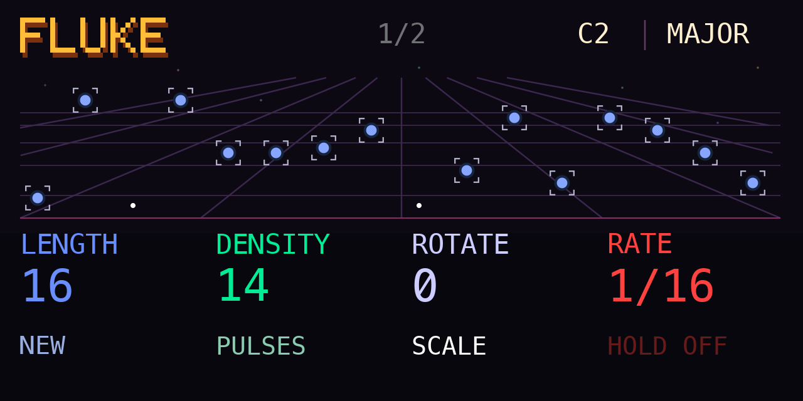
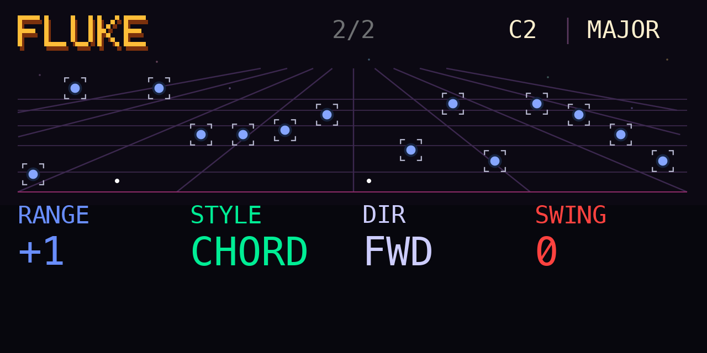

# FLUKE — Generative Sequencer for OP-1

Fluke is a generative sequencer for the OP-1, designed for musical exploration and creative expression.

Inspired by Iftah’s Sting, Mutable Instruments’ Marbles, the Torso T-1, and classic Korg sequencers, Fluke combines controlled randomness with its own unique sequencing rules.

Rather than simply programming patterns, Fluke encourages you to **play the sequencer like an instrument**, shaping evolving rhythms and melodies in real time. Experiment with different **Styles** and **Rotate** to discover unexpected musical patterns. Use **Lift** to capture your current melody, freely explore new variations, and return safely to your original idea with **Drop**.

Shape your rhythms using **Density** for varying note activity, or switch to **Pulses** for a traditional Euclidean sequencing approach. **Cut / Split** jumps back to the beginning on the next step boundary while staying in sync. Use the keyboard to select root notes and explore different musical scales.

**Fluke is all about experimentation, happy accidents, and hands-on musical expression.**

## First release 1.0.0

[Download device and PDF manual](https://github.com/VolkerJunginger/OP-1/releases/download/fluke-v1.0.0/Fluke-1.0.0.zip) · [Read the manual](Fluke%20Manual.pdf) · [Release page](https://github.com/VolkerJunginger/OP-1/releases/tag/fluke-v1.0.0)

The ZIP contains only `fluke.opmod` and `Fluke Manual.pdf`. Source and build information are in this directory.

Requires the **original OP-1**, firmware **246**, and **Opus 2.8 or newer**. Fluke plays the selected synth or sampler and produces no sound of its own.

## Install and start

Copy `fluke.opmod` to the OP-1 disk’s `mods` folder, eject, then restart. In the Synth sequencer list, select **fluke**. Open the sequencer screen and play a keyboard note. To update, replace the previous `fluke.opmod`.

Each load or reselection generates a fresh melody and restores the default settings. Press blue on Main for a new melody. The keyboard changes the root note without restarting a running sequence.

## Main page

| Encoder | Turn | Press |
| --- | --- | --- |
| Blue | Length, 1–16 steps | New melody |
| Green | Density, 1–16, or Pulses, 0–Length | Toggle Density / Pulses |
| White | Rotate, 0–Length−1 | Next scale |
| Orange | Rate | Hold on/off |

**Length** sets the visible loop. **Rotate** shifts only the visible notes and rhythm, wrapping at the current Length. Shortening hides the tail; increasing Length reinserts hidden notes in their original circular order.

**Density** adds or removes notes using the generated rhythm. **Pulses** spreads an exact number of hits evenly through the loop. For example, 3 pulses over 8 steps fall on 1, 4 and 7. Zero pulses is silent.

**Rate** runs from 1/32 to a whole note, including triplet and dotted divisions. Turn orange right for faster playback, left for slower playback. With **Hold** off, releasing the last keyboard key stops the sequence; with Hold on, it keeps playing.

Blue dots and brackets show notes; small white dots mark rests. The green line marks the current step. Root and scale appear together at the top right.

## Page two

Hold **Shift** to open **2/2**; release it to return to Main. Encoder presses have no action on this page.

| Encoder | While holding Shift |
| --- | --- |
| Blue | Range, −3 to +3 |
| Green | Style |
| White | Direction |
| Orange | Swing, 0–100 |

**Range** changes the pitch span around the root without transposing it. At 0, notes stay within the root’s octave. Positive values add upper octaves; negative values include lower octaves. The default is +1.

**Direction:** Fwd plays first to last; Rev plays last to first; F+R travels forward and back without repeated endpoints. Jump plays odd steps, then even steps. RJump reverses that order. All follow the current Length.

**Swing** delays alternate playback positions by up to half a step.

## Styles and scales

Styles reshape the current generated material rather than choosing a new seed.

| Style | Character |
| --- | --- |
| Scale | Selected scale’s full note vocabulary |
| Chord | Favors stronger chord tones |
| Fifth | Root and fifth |
| Root | Root across available octaves; one pitch at Range 0 |
| Triad | Root, third and fifth |
| Walk | Mostly neighboring scale tones |
| Leap | Wider intervals with occasional stepwise recovery |
| Motif | A short idea with small variations |
| Reply | A phrase followed by a changed response |
| Anchor | Roots alternating with other scale tones |

Press white on Main to cycle **Chromatic, Major, Minor, Major pentatonic, Dorian, Mixolydian**. The existing melody follows the new scale. Their short screen labels are CHROM, MAJOR, MINOR, PENT, DORIAN and MIXO.

## Save and return

There is one saved pattern containing the notes, rhythm, hidden notes, rotation, scale and sequencer settings.

- **Lift:** save the current pattern; the monochrome SAVED popup confirms the write.
- **Drop:** recall it on the next existing step boundary, beginning at visible step one.
- **Cut / Split:** jump the current sequence to visible step one on the next step boundary and continue in the chosen Direction.

Recall preserves clock timing. If the saved Rate differs, it takes over at the recall boundary. A stopped sequence stays stopped; Hold and physically held keys stay current. Shift + Lift/Drop have no action.

The saved pattern persists across restart but is never recalled automatically. Press Drop to return to it. New does not overwrite it. NO SAVE means no valid snapshot is available. If SAVE FAIL appears, retry Lift; the newest pattern may be available only until restart.

## Credits and validation

Created by **Volker / ESC_CODE**. The generator includes an integer adaptation of **Mutable Instruments Marbles by Emilie Gillet**, retaining its MIT notice in [LICENSE-Marbles.txt](Source/esc.fluke/LICENSE-Marbles.txt). Sting, Torso T-1 and classic Korg sequencers are creative influences; Fluke is an independent project.

The native port is distributed under [GPL-3.0](LICENSE), with third-party notices preserved. Built with the [Opus plugin kit](https://github.com/LizardMan245/opus/tree/main/plugin-kit); no firmware is distributed. See [source and build instructions](Building.md).

Version 1.0.0 passed desktop build and functional checks. Physical OP-1 loading, timing, display and performance verification remains pending. CPU is unmeasured. Screenshots are desktop previews with approximate lettering; the device uses the OP-1 font.
