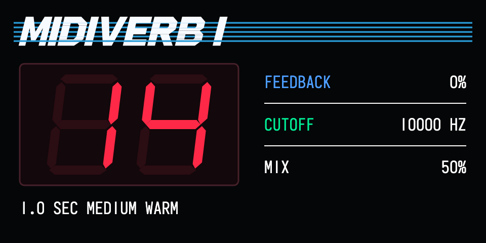

# Midi-Reverb 1.0.0

Mono ROM-based reverb/effects for the original OP-1 (firmware 246), requiring Opus core 2.31 or later. Built with the 2.33 SDK baseline. This version migrates the 0.2.9 DSP to the native effect interface, so `midireverb` can be selected as the first effect or by a second-slot FX manager such as FX Overdrive. The mods-list name is **Midi-Reverb**; plugin ID `esc.midireverb`; filename `midireverb.opmod`.

[**Download Midi-Reverb 1.0**](https://raw.githubusercontent.com/VolkerJunginger/OP-1/main/Midi-Reverb/midireverb.opmod) · [**Complete package and source**](Midi-Reverb-1.0.0.zip)

*Rendered screen preview of the unchanged layout with ROM bank I selected. Hardware display validation for this native release remains pending.*

## Install

1. Copy `midireverb.opmod` to the mods folder. there
2. Keep your existing `mods/mv1rom/` folder. Eject and restart the OP-1.
3. Select `midireverb` in the normal synth/drum FX selector, or in your second-slot FX manager. The manager must support native Opus effects.

No ROMs are distributed. You must supply your own compatible ROM dumps and rename them exactly:

| ROM | Filename in mods/mv1rom | Size | CRC32 |
| --- | --- | --- | --- |
| MidiVerb I DSP | `midiverb.bin` | 16,384 bytes | de8ca203 |
| MidiVerb II DSP | `midiverb2.bin` | 32,768 bytes | 2dd24b56 |
| MidiFex DSP | `midifex.bin` | 16,384 bytes | 098cc1b4 |

Missing/invalid banks are skipped. These filenames and the original ROM names displayed in the changing logo identify the source hardware bank; the device itself is Midi-Reverb. Unrelated controller ROMs will not enable a bank.

## Controls

| Encoder | Turn | Press |
| --- | --- | --- |
| Blue | Feedback | — |
| Green | Cutoff, 1–11 kHz | — |
| White | Mix | — |
| Orange | Program | Change ROM |

ROM order: MidiVerb I → MidiVerb II → MidiFex. Each instance remembers a different preset for each ROM. The eight effect parameters carry the selected ROM, controls and the remembered presets when the host saves its effect record. The original screen layout, centered red seven-segment display and parameter alignment are retained. No clear-tail control, input encoder or output encoder.

The first and second instances have independent delay memory, controls and ROM selection. Changing a ROM/program or engine clears that instance's tail. A new or explicitly reselected effect starts from its defaults: first available ROM, first preset, Feedback 0%, Cutoff 10 kHz, Mix 50%. Synth reloads that reuse the same effect instance preserve the effective controls and tail. This lifecycle behavior passed mocked desktop tests; verify it with the actual OP-1/FX manager before relying on it.

Mono synth/drum only. Master processing is bypassed; selecting it there does not provide a stereo reverb.

## Opus settings

Select Midi-Reverb in the mods list and press Blue:

- **Output-Filter:** On by default; the existing wet-only reconstruction filter. Off bypasses it.
- **Engine:** Original by default; Low CPU selects the existing approximate tank for supported presets, with original fallback for the others.

These two plugin settings apply to all instances. Using two Original engines adds processing load. This release does not claim a CPU reduction or achievement of the 3% target.

## Verification and device check

Desktop checks passed: Blackfin build and two-base link/package checks; SVG zero errors/warnings; AddressSanitizer/UndefinedBehaviorSanitizer; three mocked native instances (two on the same synth owner plus drum); control/ROM/preset/tail isolation; preset memory per ROM; factory reload preservation and explicit re-selection reset; screen selection using opus_page_now; ROM import; settings and master bypass. Native adapter output matched the unchanged 0.2.9 DSP for all 227 programs in both engine modes over 14,528 audio blocks (929,792 samples).

## Credits and license

- [Opus](https://github.com/LizardMan245/opus), LizardMan245, provides the firmware framework and SDK.
- [MIDIVerb_RE](https://github.com/emeb/MIDIVerb_RE), Eric Brombaugh, with Paul Schreiber's reverse-engineering work, is the MidiVerb I reference.
- [midiverb_emulator](https://github.com/thement/midiverb_emulator), thement, provides the MidiVerb II/MidiFex program and LFO implementation.
- Native Opus adaptation and Midi-Reverb integration: ESC_CODE / Volker.

See `Source/LICENSE` and `Source/MIDIVerb_RE-LICENSE`. This is an independent project, not affiliated with, endorsed by, or supported by Alesis. Hardware and ROM names identify compatibility only. ROMs are not included or licensed by this package.
