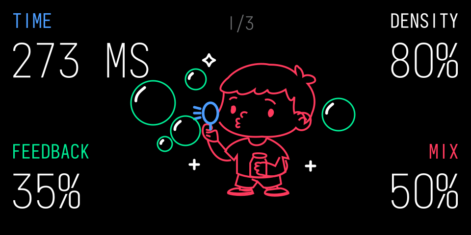
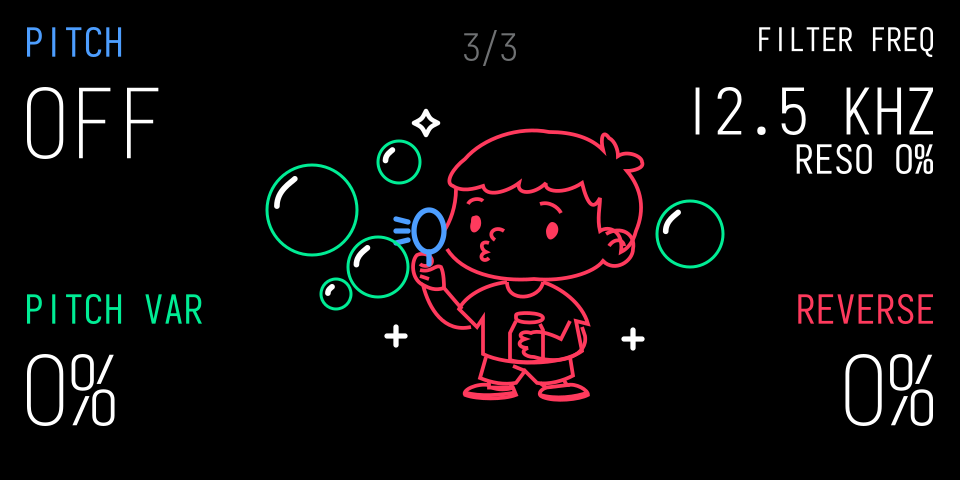
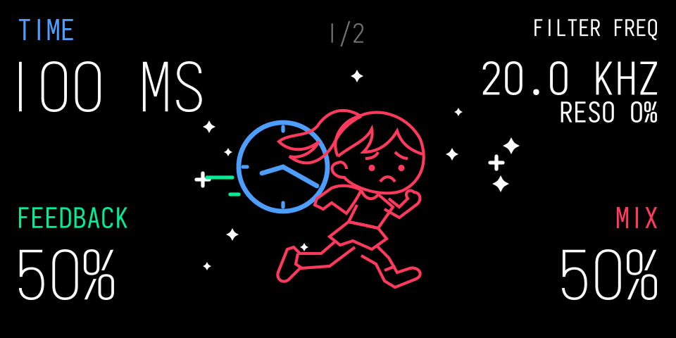
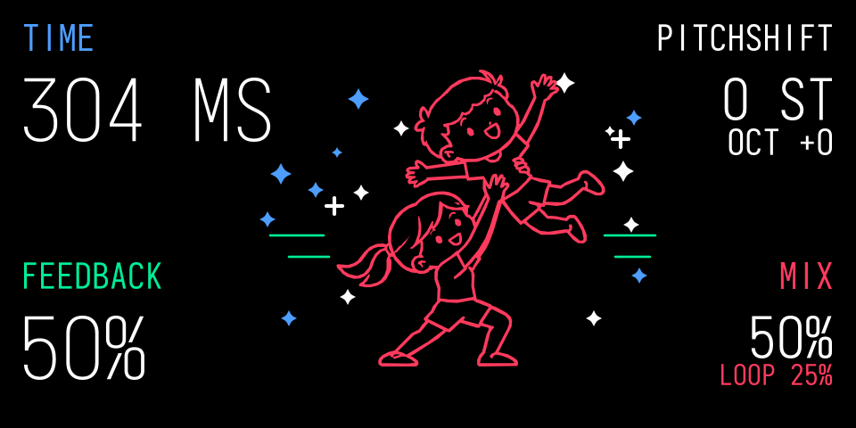

# ESC Delay Trio

Three instrument effects for the **original OP-1**, ported and adapted from Tom Erbe / SoundHack’s **+bubbler, +delay and +pitchdelay** using the Opus framework.

| Device | Version | Download |
| --- | --- | --- |
| Bubbler | 1.1.12 | [bubbler.opmod](Bubbler/bubbler.opmod) |
| Delayed | 0.3.4 | [delayed.opmod](Delayed/delayed.opmod) |
| Pitch Delay | 0.3.3 | [pitchdelay.opmod](Pitch-Delay/pitchdelay.opmod) |

[Download the complete release](Delay-Trio.zip) · [Manual](Manual.md) · [Credits and licences](Credits.md)

Requires original OP-1 firmware 246 and Opus 2.6. These are instrument effects, not master effects. Each has a one-second maximum delay time. OP-1 Field and OP-XY are not supported.

Copy the three `.opmod` files to the OP-1’s `mods` folder in disk mode, eject safely and restart. Select the effect on a synth or drum instrument. See the manual before upgrading from older standard-format builds.

The preceding three-device behavior update was confirmed on the original OP-1 by the user on 2 November 2026. Bubbler 1.1.12 adds the requested page 3 controls and pitch choices; its desktop checks pass, and no separate hardware confirmation for this version is recorded. Delayed includes the confirmed LFO and filter-decay audio fix. Fresh effect selection restores defaults, and Help leaves Delayed and Pitch Delay unchanged. Saved-preset recall and FX OFF/ON retain settings. CPU depends on settings; no new CPU measurement is claimed.

Complete device source is included beside each binary. See [Building](Building.md). GPL-3.0-or-later applies to the ports; original SoundHack notices are retained separately.

## Screen previews

Desktop previews of the current default screens; Iosevka lettering approximates the native font. These are not device photographs.

### Bubbler

Page 3: Blue Pitch, Green Pitch Var, White Filter Freq (push for Reso), Orange Reverse. Pitch starts at Off, with negative intervals to the left and key/positive intervals to the right.

### Delayed

### Pitch Delay

